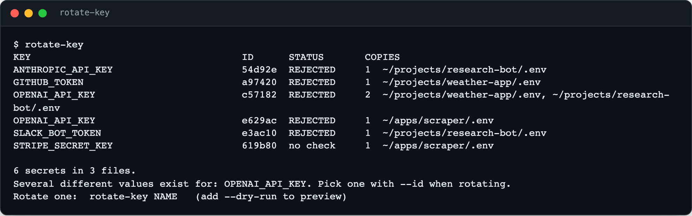
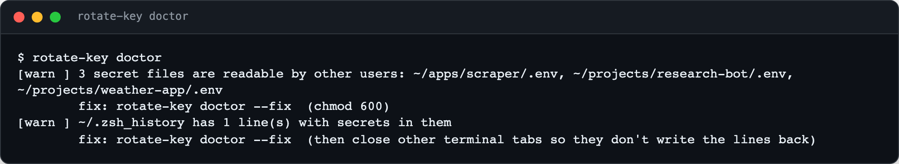

<div align="center">

<h1>rotate-key</h1>

<p><b>Every copy of every API key, found, checked and replaced in one step.</b></p>

<p><i>A leaked key is a five-minute fix at the provider and an afternoon of hunting through .env files on your own machine.</i></p>

<h6>


</h6>

<a href="#install"><b>Install</b></a> ·
<a href="#use-it"><b>Use it</b></a> ·
<a href="#doctor"><b>Doctor</b></a> ·
<a href="#doing-it-properly"><b>Doing it properly</b></a>

<br><br>



<sub>Demo keys, so every provider rejects them. Values are never printed; the ID is a short hash.</sub>

</div>

<br>

## The problem

The same key ends up in six places: a project `.env`, a copy for a second project, an agent's
config, a CLI's settings file, a process manager's saved environment. When it leaks you revoke it
in a minute, then spend an hour finding every copy, miss one, and a service breaks at 2am.

## How it works

<table>
<tr>
<td width="33%" valign="top">

**1 · Inventory**

Walks your folders for `.env` files (and any config files you list), groups identical values,
and shows each key once with every place it is copied.

</td>
<td width="33%" valign="top">

**2 · Check**

Calls a free, read-only endpoint at each key's own provider to see whether it still works.
A key is only ever sent to the service it belongs to.

</td>
<td width="33%" valign="top">

**3 · Rotate**

Prompts for the new value without echoing it, verifies it, replaces the old value in every
copy, backs up what it changed, and restarts the services that read it.

</td>
</tr>
</table>

## Install

```bash
git clone https://github.com/parthchandak02/rotate-key.git ~/src/rotate-key
ln -s ~/src/rotate-key/rotate_key.py ~/.local/bin/rotate-key     # any folder on your PATH
```

One file, standard library only, Python 3.11 or newer.

## Use it

```bash
rotate-key                          # every secret, its copies, and whether it still works
rotate-key OPENAI_API_KEY --dry-run # what a rotation would touch
rotate-key OPENAI_API_KEY           # prompt, verify, replace everywhere, restart services
rotate-key OPENAI_API_KEY --id c57182   # when one name has several different values
rotate-key add ANTHROPIC_API_KEY    # new key: prompt, verify, append to one env file (--to FILE)
rotate-key check GITHUB_TOKEN       # just the provider check
rotate-key doctor                   # hygiene report; add --fix for the safe fixes
```

Copies inside backup or snapshot folders are listed but never rewritten: revoke the old key and
they are harmless. Every file it changes is copied first to `~/.local/state/rotate-key/<time>/`
(owner-only), and rewritten files are left readable only by you.

<details>
<summary><b>Providers it can check</b></summary>

Hevy, Gemini / Google AI, OpenAI, Anthropic, OpenRouter, DeepSeek, Fireworks, Groq, Mistral,
Typesafe, GitHub, Cloudflare, GitGuardian, Slack, Telegram, Cursor, Semantic Scholar, Elsevier /
Scopus, CORE, PubMed (NCBI) and CapSolver. Matching is by variable name. Add your own in the
config:

```toml
[checks.MY_SERVICE_TOKEN]
url = "https://api.example.com/v1/me"
header = "Authorization: Bearer {k}"
```

</details>

<details>
<summary><b>Configuration</b></summary>

Optional, at `~/.config/rotate-key/config.toml`. See [`config.example.toml`](config.example.toml).

| Setting | Default | |
|---|---|---|
| `roots` | `["~"]` | Folders searched for `.env` files |
| `depth` | `6` | How deep to search |
| `extra_files` | `[]` | Globs for non-.env files that hold copies (CLI configs) |
| `backup_dirs` | `state-snapshots`, `backups`, `backup` | Copies here are reported, not rewritten |
| `add_to` | `".env"` | Env file `rotate-key add` writes to (`--to` overrides) |
| `restart.launchd` | `[]` | LaunchAgent labels to restart after a rotation |
| `restart.pm2` | `"auto"` | Restart pm2 processes whose environment has the key |
| `restart.commands` | `[]` | Any other commands to run afterwards |

</details>

## Doctor

<div align="center">

<br><sub>Demo run. The macOS checks are left out of the picture.</sub>
</div>

`rotate-key doctor` looks for the habits that leak keys:

- **Loose permissions.** Secret files readable by other accounts (`--fix` makes them owner-only).
- **Git.** A `.env` that is committed, or not ignored and one `git add -A` away from it.
- **Cloud sync.** Secret files in iCloud-synced Desktop or Documents.
- **Shell.** Keys hard-coded in `~/.zshrc`, and keys pasted into shell history (`--fix` removes those lines).
- **Services.** Secrets in LaunchAgent plists.
- **Tools.** A plain-text GitHub CLI token, an SSH key with no passphrase, `~/.git-credentials` or `~/.netrc`.
- **The machine.** FileVault, the firewall, Remote Login, Screen Sharing, and dev servers listening on your whole network.

## Doing it properly

rotate-key cleans up after the fact. These habits mean there is less to clean.

**Keep keys in the macOS Keychain, not in shell files.**

```bash
security add-generic-password -a "$USER" -s OPENAI_API_KEY -w          # prompts; nothing in history
export OPENAI_API_KEY="$(security find-generic-password -s OPENAI_API_KEY -w)"   # in ~/.zshrc
```

**Load per-project keys only inside the project**, with [direnv](https://direnv.net):

```bash
# .envrc (git-ignored)
export OPENAI_API_KEY="$(security find-generic-password -s OPENAI_API_KEY -w)"
```

**Or let a password manager inject them at run time**, so no file holds the value:

```bash
op run --env-file=.env.tpl -- npm start      # .env.tpl holds op://vault/item/field references
```

**Ignore every env file in every repo**, with one global rule:

```bash
printf '.env\n.env.*\n!.env.example\n' >> ~/.config/git/ignore
```

**Never paste a key on the command line.** Use `read -s` or a prompt, so it doesn't land in history:

```bash
read -rs "KEY?Key: "; export OPENAI_API_KEY="$KEY"; unset KEY
```

**Turn on secret scanning** for your GitHub repos (Settings › Code security: secret scanning and
push protection), and use one key per project so a leak only breaks one thing.

<br>

<div align="center">
<sub>MIT licensed. Standard library only.</sub>
</div>
